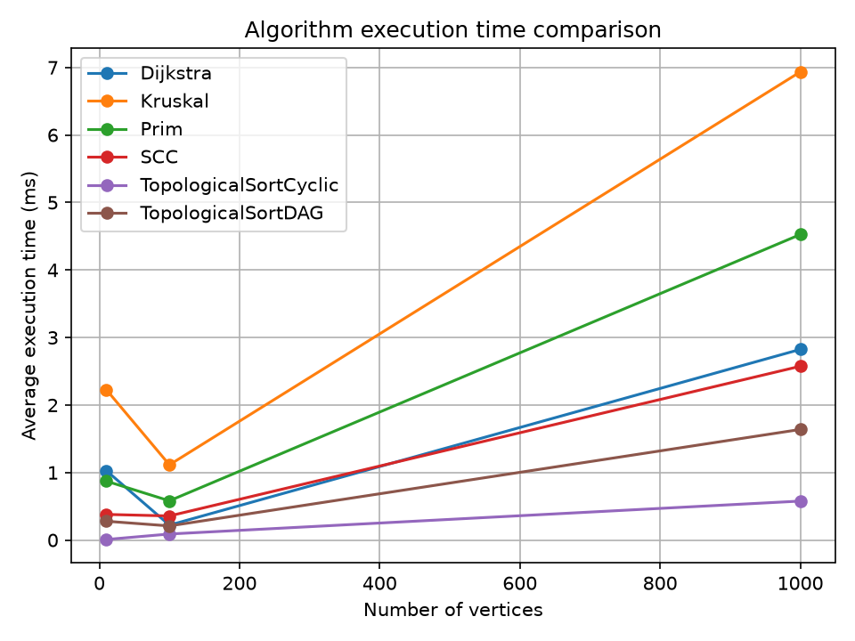
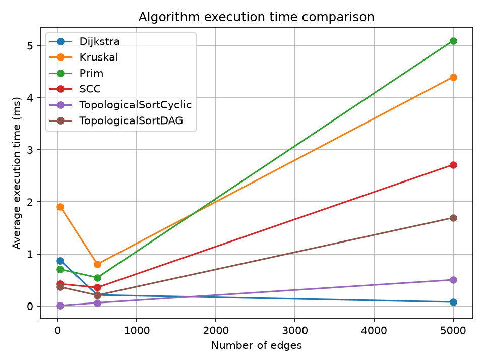

# Assignment 3 — Smart City Infrastructure and Route Planning

## 1. Project Description

This project implements graph algorithms for smart city infrastructure and route planning.

The project uses Java. It includes algorithms for finding minimum spanning trees, checking graph connectivity, finding strongly connected components, sorting graph vertices, and finding shortest paths.

## 2. Implemented Algorithms

### Minimum Spanning Tree

**Kruskal's Algorithm**
- Sorts edges by weight.
- Uses Disjoint Set Union (DSU) to avoid cycles.
- Builds a minimum spanning tree.

**Prim's Algorithm**
- Uses a priority queue.
- Adds the lowest-weight edge that connects a new vertex.
- Builds a minimum spanning tree.

### Disjoint Set Union (DSU)

DSU manages groups of connected vertices.

It uses:
- Path compression.
- Union by size.

### Graph Connectivity

**Topological Sort**
- Orders vertices in a directed acyclic graph (DAG).
- Detects cycles when a valid order is not possible.

**Strongly Connected Components (SCC)**
- Uses Kosaraju's algorithm.
- Finds groups of vertices that can reach each other.

### Shortest Path

**Dijkstra's Algorithm**
- Finds shortest distances from a source vertex.
- Uses a priority queue.
- Supports non-negative edge weights.
- Stores previous vertices to restore paths.
- Identifies unreachable vertices.

## 3. Project Structure

```text
Assignment3DAA/
├── src/
│   ├── connectivity/
│   │   ├── SCC.java
│   │   └── TopologicalSort.java
│   ├── dsu/
│   │   └── DSU.java
│   ├── graph/
│   │   └── Graph.java
│   ├── mst/
│   │   ├── Kruskal.java
│   │   └── Prim.java
│   ├── shortestpath/
│   │   └── Dijkstra.java
│   ├── Main.java
│   ├── GraphTests.java
│   └── Experiment.java
├── results/
│   ├── plots/
│   │   ├── execution_time_vs_edges.png
│   │   └── execution_time_vs_vertices.png
│   └── results.csv
├── plot_results.py
└── README.md
```

## 4. How to Run

### Requirements

- Java Development Kit (JDK)
- Python 3
- Matplotlib for creating plots

### Run the main program

Open the project in IntelliJ IDEA and run `Main.java`.

### Run tests

Run `GraphTests.java`.

The program should print:

```text
All tests passed.
```

### Run experiments

Run `Experiment.java`.

The program creates `results/results.csv` with the experiment results.

### Create plots

Open a terminal in the project directory and run:

```bash
py -m pip install matplotlib
py plot_results.py
```

The plots are saved in `results/plots/`.

## 5. Performance Experiments

The experiments use graphs with different numbers of vertices and edges.

| Graph size | Vertices | Edges |
|---|---:|---:|
| Small | 10 | 30 |
| Medium | 100 | 500 |
| Large | 1000 | 5000 |

Each experiment runs five times. The program calculates the average execution time using `System.nanoTime()`.

The random seed is fixed to make graph generation repeatable.

The CSV file stores:
- Algorithm name
- Number of vertices
- Number of edges
- Average execution time in nanoseconds
- Number of counted operations

The project compares Kruskal and Prim, and measures Dijkstra, SCC, and topological sorting on different graphs.

## 6. Experimental Results

### Execution Time vs Number of Vertices

This graph compares the execution time of the algorithms for different numbers of vertices.



### Execution Time vs Number of Edges

This graph compares the execution time of the algorithms for different numbers of edges.



The experiments use three graph sizes: 10, 100, and 1000 vertices. Each experiment runs five times, and the average execution time is saved in `results/results.csv`.


## 7. Time and Space Complexity

Let `V` be the number of vertices and `E` be the number of edges.

| Algorithm | Time Complexity | Space Complexity |
|---|---|---|
| DSU operations | Nearly O(1) amortized | O(V) |
| Kruskal | O(E log E) | O(V + E) |
| Prim with a priority queue | O(E log V) | O(V + E) |
| Topological Sort | O(V + E) | O(V) |
| Kosaraju's SCC | O(V + E) | O(V + E) |
| Dijkstra with a priority queue | O((V + E) log V) | O(V + E) |

## 8. Tests

`GraphTests.java` checks important cases, including:

- Minimum spanning tree results
- Disconnected graphs
- Cycles in topological sorting
- Strongly connected components
- Shortest path distances
- A graph with one vertex

The tests passed during project development.

## 9. Conclusion

This project demonstrates how graph algorithms can solve problems related to smart city infrastructure and route planning.

The experiments help compare algorithm performance on graphs of different sizes.
